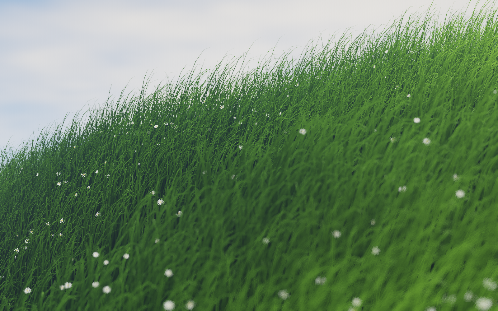
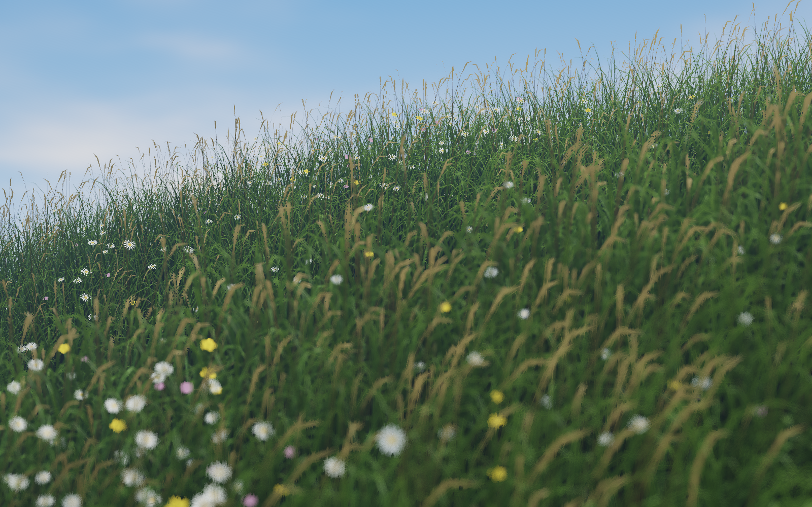
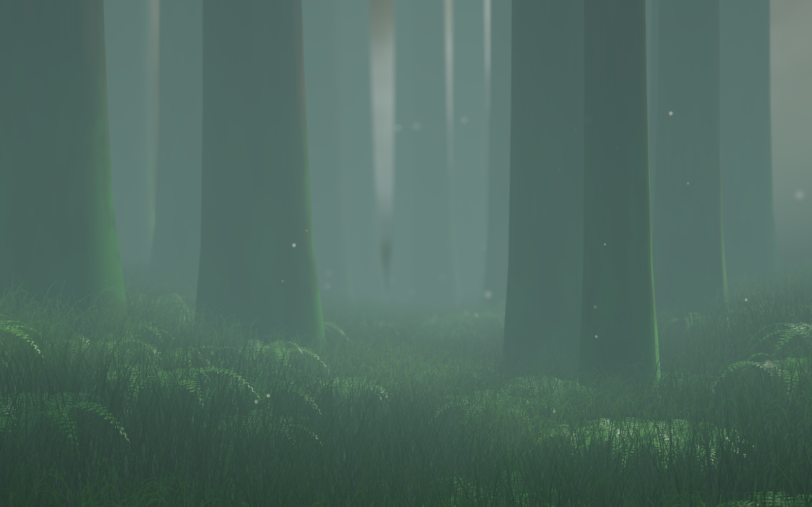
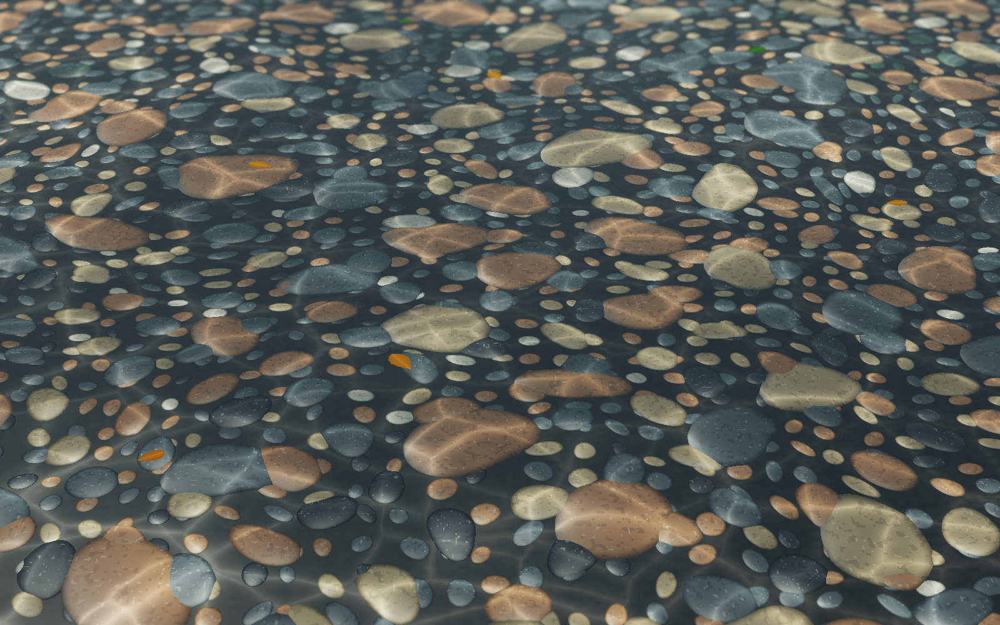
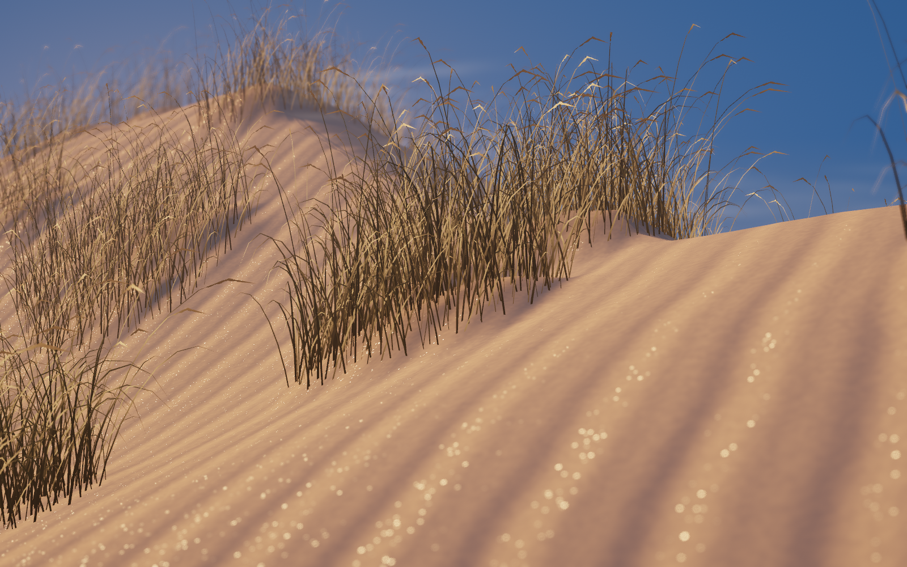
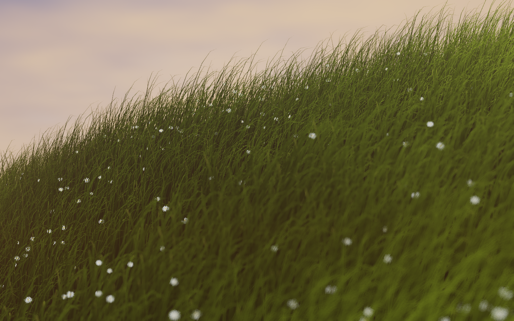

# Canopy

**A living, photorealistic macOS desktop — rendered entirely on your GPU.**

Canopy replaces your static wallpaper with real-time procedural nature: rolling grass meadows, an old-growth forest floor, a shallow stream, and coastal dunes — all live-rendered in Metal, all subtly reactive to your system load, cursor movement, and the time of day.

No game engine. No video loops. No permissions prompts. ~60 MB of RAM and single-digit CPU/GPU usage on Apple Silicon.

| Grass-Swept Meadow | Wild Meadow | Misty Moss & Fern |
| :---: | :---: | :---: |
|  |  |  |

| Forest Stream | Coastal Dunes | Golden Hour |
| :---: | :---: | :---: |
|  |  |  |

---

## Scenes

- **Grass-Swept Meadow** — 84k instanced fescue blades in organic tussocks with root occlusion, backlit subsurface scattering, chamomile florets, drifting seed bokeh, and a real clouded sky.
- **Wild Meadow** — golden seed culms, oxeye daisies, buttercups, and clover under the same rolling wind field.
- **Misty Moss & Fern Floor** — an old-growth clearing: layered trunks receding into fog, 61k woodland blades, sword ferns, dew, and dust motes glimmering through sunbeams.
- **Shallow Forest Stream** — ray-refracted water over granite cobbles, dancing caustics, and drifting leaves.
- **Coastal Dunes** — raking light across wind-carved sand micro-ripples, marram grass, and saltation mist.

## It's alive

Everything on screen is driven by a shared organic physics bus — not canned animation:

| Signal | Effect |
| :--- | :--- |
| **CPU load** (Mach `host_statistics64`, smoothed 5–13s) | Heavy builds roll in as slow weather gusts; idle settles to a calm breeze |
| **Cursor position & velocity** (`NSEvent.mouseLocation`) | A damped breeze wake parts grass and stirs dust as you move — no accessibility permissions required |
| **Network / disk bursts** | Extra pollen, seeds, and spores lift into the bokeh layer |
| **Real sun position** | Auto Solar computes true solar elevation (NOAA equations) at your inferred location: misty dawn → lush day → golden hour → moonlit night, tracking real sunrise/sunset through DST and seasons (or pin Light Lush / Golden Hour / Dark Moody) |

## Featherweight by design

- **Occlusion pause** — polls `CGWindowListCopyWindowInfo` twice a second; when windows cover >92% of the desktop, rendering drops to **0% GPU, 0% CPU** until you peek at the desktop again.
- **Adaptive frame rate** — 60 fps while things are moving, coasting to 24–30 fps when calm.
- **Power aware** — auto-pauses on Low Power Mode and display sleep.
- **Hardware resolve path** — Apple Silicon `.memoryless` 4x MSAA with min-depth resolve, `rgba16Float` HDR, a 64-tap Vogel-disk bokeh pass, ACES tone mapping, and blue-noise dither — all in one Metal pipeline.

## Menu bar

A leaf icon lives in your status bar. The popover gives you:

- Scene picker (all 5 scenes)
- Lighting mode: Auto Solar / Light Lush / Golden Hour / Dark Moody — Auto shows today's computed sunrise/sunset under the picker so you can cross-check it against the real sky
- Location for Auto Solar is inferred offline from your system time zone (no Location Services prompt); pin an exact spot if needed:
  ```bash
  defaults write com.kavi.canopy solarLatitude  -float 42.36
  defaults write com.kavi.canopy solarLongitude -float -71.06
  ```
- Wind sensitivity, cursor wake, bokeh depth, and FPS sliders
- Preview window toggle
- Procedural wind audio (a lock-free `AVAudioSourceNode` pink-noise + resonant bandpass synth driven by the *same* wind buffer as the visuals — muted by default)

## Build & run

Requires macOS 14+ on Apple Silicon and a Swift 6 toolchain.

```bash
git clone https://github.com/kvas-bit/Canopy.git
cd Canopy
make            # compile .metal shaders → default.metallib, bundle Canopy.app
make run        # launch the menu bar app
make install    # copy Canopy.app to /Applications
```

Verification:

```bash
swift test      # physics, solar, struct-alignment, and headless GPU render tests
make snapshot   # render HDR PNGs of every scene to .build/snapshots/
```

## Architecture

```
Sources/CanopyKit/
├── Engine/        # MetalRenderer, OrganicPhysicsBus, SystemTelemetrySampler,
│                  # LightingRig, PowerCoordinator, SnapshotExporter
├── Scenes/        # One MetalScene per environment — plug in a new .metal + .swift pair
├── Shaders/       # Meadow, WildMeadow, Moss, Stream, Dunes, PostProcess + ShaderShared.h
├── Audio/         # Procedural wind/water synth
└── App/           # kCGDesktopWindowLevel window manager, preview window, SwiftUI popover
```

A new scene only needs to conform to `MetalScene` — it automatically inherits telemetry, cursor wakes, solar lighting, HDR bokeh, occlusion pausing, and snapshots.

## License

[MIT](LICENSE) © Kavi Vasudeo
